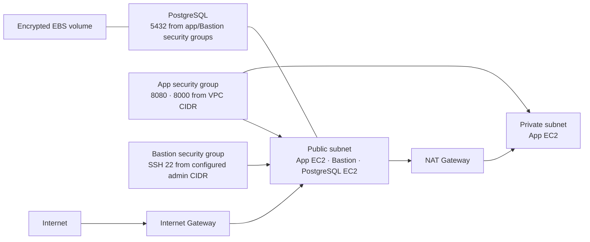

# AWS Terraform 인프라

AWS 서울 리전에 개발용 네트워크, EC2, PostgreSQL 컨테이너, IAM 권한을 구성하는 Terraform 프로젝트입니다.
각 번호 폴더는 독립된 Terraform root module과 로컬 state를 사용합니다.

## 구성

| 폴더 | 역할 |
| --- | --- |
| `01_network` | VPC, 퍼블릭/프라이빗 서브넷, Internet Gateway, NAT Gateway와 라우팅 |
| `02_compute` | 애플리케이션 EC2 2대, Bastion EC2, 보안 그룹 |
| `03_database` | PostgreSQL 16 컨테이너용 EC2, 보안 그룹, 암호화된 EBS 데이터 볼륨 |
| `04_iam` | `developers` 그룹과 `PowerUserAccess` 권한을 가진 개발자 IAM 사용자 |
| `scripts` | Amazon Linux 2023 EC2 첫 부팅 시 Docker 설치 스크립트 |

기본 VPC CIDR은 `10.0.0.0/16`입니다. 퍼블릭 서브넷에는 애플리케이션 EC2, Bastion, DB EC2를 두며,
DB EC2는 공인 IP가 있어도 보안 그룹이 앱/Bastion 보안 그룹에서 오는 `5432/tcp`만 허용합니다.
프라이빗 서브넷에는 앱 EC2를 두고, 외부 패키지 다운로드는 NAT Gateway를 통해 나갑니다.



## 적용 순서

`02_compute`와 `03_database`는 앞 단계의 로컬 Terraform state를 읽기 때문에, 저장소 루트에서 순서대로 적용합니다.

```sh
terraform -chdir=01_network init
terraform -chdir=01_network plan
terraform -chdir=01_network apply

terraform -chdir=02_compute init
terraform -chdir=02_compute plan
terraform -chdir=02_compute apply

export TF_VAR_db_password='강한-비밀번호-입력'
terraform -chdir=03_database init
terraform -chdir=03_database plan
terraform -chdir=03_database apply
unset TF_VAR_db_password

terraform -chdir=04_iam init
terraform -chdir=04_iam plan
terraform -chdir=04_iam apply
```

AWS 자격 증명은 Terraform 코드에 넣지 말고 AWS CLI profile이나 IAM Identity Center 자격 증명으로 공급하세요.
리전 기본값은 `ap-northeast-2`입니다.

## 주요 변수

각 폴더에서 `terraform.tfvars`를 만들거나 `-var`/환경 변수를 사용해 값을 지정합니다. 실제 값이 든
`*.tfvars` 파일은 Git에 올리지 마세요.

`02_compute/terraform.tfvars` 예시:

```hcl
# 생략하면 애플리케이션 포트는 VPC CIDR에서만 허용
allowed_cidr_blocks = ["10.0.0.0/16"]

# 실제 관리용 공인 IP와 AWS에 이미 생성한 키 페어 이름으로 설정
bastion_allowed_cidrs = ["203.0.113.10/32"]
bastion_key_name      = "my-admin-key"
```

`03_database`는 `TF_VAR_db_password`를 필수로 받습니다. 비밀번호는 EC2 user data를 통해 전달되므로,
인스턴스 user data에 접근할 수 있는 IAM 권한과 Terraform state를 보호하세요.

## 비용 및 보안 참고

- NAT Gateway, EC2, EBS, 데이터 전송, 퍼블릭 IPv4에는 AWS 요금이 발생할 수 있습니다.
- 애플리케이션 보안 그룹은 기본적으로 `8080/tcp`, `8000/tcp`를 VPC CIDR에서 허용합니다.
- Bastion SSH는 기본 차단입니다. `bastion_allowed_cidrs`에 관리용 IP를 지정해야 열립니다.
- DB 포트는 앱 및 Bastion 보안 그룹에만 허용하며, DB에 SSH 인바운드는 열지 않습니다.
- `04_iam`의 `PowerUserAccess`는 대부분의 AWS 서비스 권한을 허용합니다. IAM 권한 관리는 제외하지만,
  고비용 리소스를 생성할 수 있습니다. 사람 계정은 가능하면 IAM Identity Center를 사용하세요.
- 이 구성은 각 단계의 state를 로컬 파일에 저장합니다. `terraform.tfstate`, 백업, plan, `tfvars`는
  민감 정보나 인프라 정보를 담을 수 있으므로 커밋하지 마세요. 루트 `.gitignore`에서 제외합니다.
- `.terraform.lock.hcl`은 provider 버전 잠금 파일이며 저장소에 커밋합니다.

## 출력 확인

각 모듈의 출력값은 해당 폴더를 지정해 확인합니다.

```sh
terraform -chdir=02_compute output
terraform -chdir=03_database output
terraform -chdir=04_iam output
```
